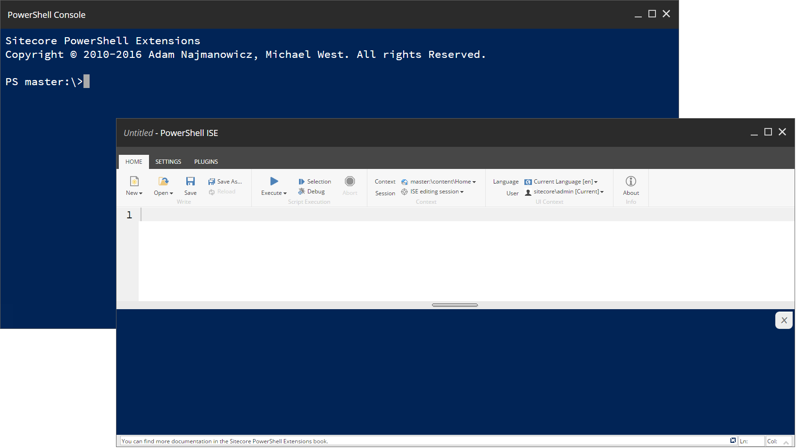

# Sitecore PowerShell Extensions

A command line and scripting tool built for the Sitecore platform.



---

## Notice

>
* If you are using version 4.2 or older in your environments we recommend you update them to 5.0+ ASAP
* We recommend that you DO NOT install SPE on Content Delivery servers
or run it in setups that face the Internet in an unprotected connections
(e.g. outside of a VPN protected environment)
* Sitecore versions 7.x and below are no longer supported with the release of SPE 5.0
---

[](https://opensource.org/licenses/MIT)

The Sitecore PowerShell Extensions module (SPE) provides a robust environment for automating tasks within Sitecore.


## Prerequisites

- [Task](https://taskfile.dev/) - install via `winget install Task.Task`, `choco install go-task`, or `scoop install task`
- Docker Desktop for Windows, switched to Windows containers (Compose v2.30+ for the Solr `post_start` hook)
- Visual Studio 2022+ with the .NET desktop workload

The Docker stack runs Sitecore XM1 10.5 on `ltsc2022`: Traefik, SQL Server 2025,
Solr 10, Sitecore Identity Server 9.0, and a CM role.

## Quick Start

Run `task --list` to see all available commands.

### Local IIS development

If you have Sitecore installed locally (not Docker), use the `local:` tasks:

1. Copy `src/deploy.user.json.sample` to `src/deploy.user.json`
2. Edit it to point to your Sitecore webroot(s) and set `"junction": true`
3. Build and deploy:

```powershell
task local:deploy
```

This finds MSBuild via vswhere, restores NuGet packages, rebuilds the solution, and deploys to all sites in your `deploy.user.json`. With junctions enabled, JS/CSS/XML/config edits are live instantly - only C# changes need a redeploy.

To run Playwright UI tests against your local site, add a `test` block to your site in `deploy.user.json` (see sample file), then:

```powershell
task ui:test
```

See [src/DEPLOYMENT.md](src/DEPLOYMENT.md) for the full configuration reference.

### Docker development

```
task init            # Set up local dev environment (license, certs, .env)
task up              # Start Docker environment
task down            # Stop Docker environment
task logs            # Tail CM container logs
task build           # Build the solution
task deploy          # Deploy build output to Docker container
task generate        # Generate .dat files from serialized content
task release         # Build release packages
task verify          # Validate packages against serialized items
task test            # Run integration tests
task clean           # Clean build artifacts
```

First-time setup:

```powershell
task init -- -LicenseXmlPath "C:\path\to\license.xml"
task up
task build
task deploy
```

## Troubleshooting: Docker

### Identity Server crashes with `NullReferenceException` on JWKS endpoint

**Symptom:** The Identity Server container logs show:

```
Duende.IdentityServer.Hosting.IdentityServerMiddleware [Fatal]
Unhandled exception: "Object reference not set to an instance of an object."
```

Requests to `https://speid.dev.local/.well-known/openid-configuration/jwks` return `500 Internal Server Error`.

**Cause:** The `SITECORE_ID_CERTIFICATE` in `.env` contains an **ECC (Elliptic Curve)** certificate. Sitecore Identity Server (Duende IdentityServer) requires an **RSA** certificate for JWT token signing. When it tries to extract the RSA key from an ECC cert, it throws a `NullReferenceException`.

**Fix:** Regenerate the certificate and restart the containers:

```powershell
task init -- -LicenseXmlPath "C:\path\to\license.xml"
docker compose down
task up
```

The `cert.ps1` script generates `devcert.pfx` as an RSA certificate with legacy PFX encryption, which is compatible with both Traefik (TLS) and Identity Server (JWT signing).

It also copies the public certificate into `docker/shared/certs`, which is mounted
as `C:\certs` in the CM container. The Sitecore entrypoints import every `.crt`
found there into the container's trust store, so CM trusts the dev certificate
when it self-calls over HTTPS through Traefik.

### SQL Server and TLS

This dev stack does not give SQL Server a custom TLS certificate. The
`mssql-developer:2025` image registers a mounted PFX into `LocalMachine\My`
without persisting its private key, so SQL cannot complete a TLS handshake and
every client connection times out. SQL therefore serves its own self-generated
certificate, and Identity Server connects with
`Encrypt=true;TrustServerCertificate=true`. Traffic is still encrypted; the
certificate is simply not validated, which is acceptable for a local container.

### Upgrading an environment from Sitecore 10.4

**Symptom:** After pulling the 10.5 change, `mssql` fails to attach its databases or
`solr-init` fails to authenticate.

**Cause:** 10.5 moves to SQL Server 2025 and Solr 10. Database files written by
SQL Server 2022 and indexes written by Solr 9 are not forward-compatible.

**Fix:** Discard the old data volumes and let the init containers re-seed:

```powershell
docker compose down -v
Get-ChildItem docker\data\mssql -Exclude .gitkeep | Remove-Item -Recurse -Force
Get-ChildItem docker\data\solr  -Exclude .gitkeep | Remove-Item -Recurse -Force
Remove-Item .env
task init -- -LicenseXmlPath "C:\path\to\license.xml"
task up
```

Deleting `.env` is what picks up the new 10.5 variables from `docker/.env.template`;
`task init` only fills in values for keys that are already present in the file.

### CM logs 403 errors talking to Solr

**Symptom:** CM logs `HTTP ERROR 403 Unauthorized request` against a URL like
`/solr/sitecore_core_index/schema`, and index initialization fails.

**Cause:** Usually a *missing collection*, not an authentication problem. Solr 10
grants the connection user access per collection, so its permission names the
collection explicitly. If the collection does not exist, no permission matches
and the request falls through to the catch-all `all` permission, which only the
admin role has. The result is a 403 rather than the 404 you would expect.

Collections go missing when Solr's data is partially cleared, because
`solr-init` refuses to run if any Sitecore collection is present. It logs
`Sitecore collections are already exist` and exits without creating the others.

**Fix:** Check what actually exists, and if any are missing, clear Solr's data
so `solr-init` can create all of them:

```powershell
# List collections (SOLR_ADMIN_PASSWORD comes from .env)
curl -u "admin:<SOLR_ADMIN_PASSWORD>" "http://localhost:8984/solr/admin/collections?action=LIST"

docker compose stop solr
# docker/data/solr is owned by the container account, so clear it from a container
docker run --rm -v "${PWD}\docker\data\solr:C:\data" mcr.microsoft.com/powershell:lts-windowsservercore-ltsc2022 `
  pwsh -NoProfile -Command "Get-ChildItem C:\data -Force | Where-Object Name -ne '.gitkeep' | Remove-Item -Recurse -Force"
docker compose start solr
docker compose up -d --force-recreate solr-init
docker compose restart cm
```

### Solr admin UI asks for credentials

Solr 10 enables Basic Auth. `task init` generates `SOLR_ADMIN_PASSWORD` in `.env`;
sign in at `http://localhost:8984` as `SOLR_ADMIN_USERNAME` (`admin` by default).
Sitecore itself connects as `SOLR_CONNECTION_USERNAME` (`sitecore`).

### Identity Server container is not healthy

**Symptom:** `docker compose ps` shows the `id` container as unhealthy, and other services that depend on it fail to start or authenticate.

**Common causes:**
- **Database not ready** - the `mssql-init` container hasn't finished seeding the Core database. Wait and check `docker compose logs mssql-init`.
- **Certificate issues** - see the JWKS error above.
- **Missing `.env` values** - ensure `SITECORE_ID_CERTIFICATE`, `SITECORE_ID_CERTIFICATE_PASSWORD`, and `SITECORE_IDSECRET` are set. Run `task init` to regenerate them.

## Directory Layout

```
├── .github/              GitHub Actions workflows
├── docs/                 Images and documentation assets
├── src/                  .NET source code + build scripts
│   ├── Spe/              Main project
│   ├── Spe.Abstractions/
│   ├── Spe.Sitecore92/
│   ├── Spe.Package/
│   ├── Post_Build.ps1    Deployment script (copies build output to sites)
│   ├── Deploy_Functions.ps1
│   ├── deploy.json       Shared deployment config (projects, junctions)
│   ├── deploy.user.json  Per-developer site paths + credentials (gitignored)
│   └── DEPLOYMENT.md     Full deployment configuration reference
├── serialization/        SCS content serialization (YAML items)
│   ├── sitecore.json
│   └── modules/          Module definitions + serialized items
├── modules/              PowerShell remoting module (SPE)
│   └── SPE/
├── docker/               Docker build context and tooling
│   └── .env.template     Environment variable template
├── scripts/              Developer & release automation
│   ├── init.ps1          Local environment setup
│   ├── build-release.ps1 Full release pipeline
│   ├── verify-packages.ps1
│   ├── build-images.ps1
│   ├── generate-dat.ps1
│   └── setup-module.ps1
├── tests/                Test suites
│   ├── ui/               Playwright UI tests (Console, ISE)
│   ├── unit/             SPE module unit tests
│   ├── integration/      Remoting integration tests
│   ├── examples/         Script examples
│   └── fixtures/         Test data (images, archives)
├── translations/         Language CSV data
├── _output/              Build output (gitignored except configs)
├── packages/             NuGet packages (packages.config format)
├── Spe.sln               Visual Studio solution
├── docker-compose.yml    Docker Compose services
├── Taskfile.yml          Task runner configuration
└── NuGet.config
```

## Examples

Consider some of the following examples to see how SPE can improve your quality of life as a Sitecore developer/administrator:

- Make changes to a large number of pages:
```powershell
Get-ChildItem -Path master:\content\home -Recurse |
    ForEach-Object { $_.Text += "<p>Updated with SPE</p>"  }
```

- Find the oldest page on your site:
```powershell
Get-ChildItem -Path master:\content\home -Recurse |
    Select-Object -Property Name,Id,"__Updated" |
    Sort-Object -Property "__Updated"
```

- Remove a file from the Data directory:
```powershell
Get-ChildItem -Path $SitecoreDataFolder\packages -Filter "readme.txt" | Remove-Item
```

- Rename items in the Media Library:
```powershell
Get-ChildItem -Path "master:\media library\Images" |
    ForEach-Object { Rename-Item -Path $_.ItemPath -NewName ($_.Name + "-old") }
```

## Remoting Authentication

SPE remoting accepts three authentication modes. They coexist: the server looks at each incoming request's token shape and dispatches to the matching provider, so you can mix modes in the same deployment and migrate one consumer at a time.

| Mode | Where credentials live | When to pick it | Token shape |
|---|---|---|---|
| Config-level shared secret | A single secret in `Spe.config` (or a patch) | Simplest setup for trusted automation where one CI pipeline calls SPE | Client mints HS256 JWT from the shared secret |
| Shared Secret Client (per-item) | A `Shared Secret Client` item under `/sitecore/system/Modules/PowerShell/Settings/Access/Remoting Clients` | Multiple consumers that each need their own secret, policy, impersonated user, or throttling limits | HMAC JWT with a `kid` header pointing at the item's Access Key Id |
| OAuth Client (per-item) | An `OAuth Client` item mapped to a JWT `(iss, client_id)` pair | XM Cloud style integrations against an external IdP (Sitecore Identity Server, Auth0, Entra ID, Okta, Keycloak) | Externally-issued RS256 / RS384 / RS512 / ES256 JWT validated via JWKS |

The three modes run concurrently. Dispatch is driven by the JWT's `alg` header: HMAC algorithms route to the shared-secret provider (which then chooses config-level vs per-item by `kid`), and the RSA/EC algorithms route to the OAuth provider. Existing shared-secret deployments keep working unchanged when OAuth is activated.

### Remoting Client items

Per-item modes use Sitecore items under `/sitecore/system/Modules/PowerShell/Settings/Access/Remoting Clients` that derive from the abstract `Remoting Client` template. Common fields (Impersonated User, Policy, Enabled, Expires, Throttling) live on the base. The concrete subtypes add mode-specific fields:

- **Shared Secret Client** - `Access Key Id`, `Shared Secret`
- **OAuth Client** - `Allowed Issuer`, `OAuth Client Ids` (multi-line; one client_id per line)

Each item also picks a Remoting Policy (allowlist + language mode + audit level), which applies regardless of auth mode.

Save-time validators reject wildcard / reserved / shorter-than-8 `client_id` values and duplicate `(iss, client_id)` pairs across items. Saving an item invalidates the server-side cache so Enabled=false takes effect on the next request.

### How config and items layer

Both shared-secret modes (config-level and per-item) flow through the same `<authenticationProvider>` instance registered in `Spe.config`. Items contribute the credential and identity; config contributes the token-validation policy. A few consequences worth knowing before provisioning:

- **The config-level provider must be registered for any HS\* token to validate.** A Shared Secret Client item does not stand on its own: it supplies the secret, `kid`, Impersonated User, policy, throttle, and expiry. Every other validation knob (`<allowedIssuers>`, `<allowedAudiences>`, `<maxTokenLifetimeSeconds>`, `<clockSkewSeconds>`, `<detailedAuthenticationErrors>`) is read from the config-level provider. The default Spe.config already registers it, so this is usually invisible.
- **The `<sharedSecret>` element is not required for item auth.** It stays commented out in the default config and only powers the legacy no-`kid` path. Item-based clients never consult it.
- **No per-item override of validation policy.** Issuer / audience lists, token lifetime, and clock skew are one-size-fits-all across the deployment. The templates do not express, for example, a short-lived CI key alongside a long-lived automation key.
- **`iss` / `aud` are not a per-client security boundary for HMAC.** The caller mints its own token and writes whatever `iss` / `aud` it wants, so those lists cannot isolate one Shared Secret Client from another - the shared secret itself is what makes the token unforgeable. The lists still provide a useful cross-deployment sanity check (a token stamped for deployment A will not validate at deployment B if they use different values), which is why they are kept global.
- **Defaults typically work out of the box.** The shipped `<allowedIssuers>` contains `SPE Remoting` and `Web API`, `<allowedAudiences>` is empty (the request authority is auto-accepted), and the SPE PowerShell client mints with matching values. Operators adding Shared Secret Client items usually do not need to edit `Spe.config` at all; edits are only needed when tokens come from a non-default minter.

OAuth Clients follow the same split: per-item `Allowed Issuer` and `OAuth Client Ids` route the incoming token to a Sitecore identity, while the cryptographic / claim policy (`<jwksUri>`, `<allowedIssuers>`, `<allowedAudiences>`, `<requiredScopes>`) lives on the `<oauthBearer>` config entry.

### OAuth bearer setup

The provider ships as `App_Config/Include/Spe/Spe.OAuthBearer.config.example`. Copy it to `Spe.OAuthBearer.config` (drop the `.example` suffix) to activate. Unlike earlier drafts of this feature, activating OAuth does **not** replace the shared-secret provider - both providers register side by side under a plural `<authenticationProviders>` list.

Populate the four required fields before activating: `<jwksUri>`, `<allowedIssuers>`, `<allowedAudiences>`, `<requiredScopes>`. The provider validates `exp`, `nbf`, `iat`, lifetime, `iss`, `aud`, scopes, and the cryptographic signature against keys fetched from the JWKS endpoint. The Impersonated User for the authenticated session comes from the matched OAuth Client item, not the config.

The client-side entry point is `New-ScriptSession -AccessToken <jwt>`. The session reuses the token across `Invoke-RemoteScript`, `Send-RemoteItem`, and `Receive-RemoteItem` calls.

### Local testing against Sitecore Identity Server

The Docker stack already runs Sitecore Identity Server at `https://speid.dev.local`. `docker-compose.override.yml` registers a `spe-remoting` client that issues RS256 JWTs signed by IDS. This is the same IdP shape that SCS CLI authenticates against on-prem.

One-time setup:

```
task init                                                                # seeds SPE_OAUTH_CLIENT_SECRET in .env
task up && task deploy                                                   # or 'docker compose up -d id' if already up
# Activate the OAuth provider (inside the deploy output so the file watcher picks it up):
cp "docker/deploy/App_Config/Include/Spe/Spe.OAuthBearer.config.example" \
   "docker/deploy/App_Config/Include/Spe/Spe.OAuthBearer.config"
```

Fetch a token and open a remoting session (PowerShell 7+). Substitute the literal client secret below, or load `SPE_OAUTH_CLIENT_SECRET` from `.env` into the current shell first:

```powershell
$body = @{
    grant_type    = "client_credentials"
    client_id     = "spe-remoting"
    client_secret = $env:SPE_OAUTH_CLIENT_SECRET
    scope         = "spe.remoting"
}
$token = (Invoke-RestMethod -Uri "https://speid.dev.local/connect/token" -Method POST `
    -ContentType "application/x-www-form-urlencoded" -Body $body -SkipCertificateCheck).access_token

$session = New-ScriptSession -ConnectionUri https://spe.dev.local -AccessToken $token
Invoke-RemoteScript -Session $session -ScriptBlock { Get-User -Current }
```

Contributors working inside the SPE repo can skip the `Invoke-RestMethod` boilerplate and use `scripts/Get-SpeOAuthToken.ps1`, which reads `.env` and trusts the dev cert automatically.

The dev-stack defaults (`jwksUri`, `allowedIssuers`, `allowedAudiences`, `requiredScopes`) live in `z.Spe.Development.OAuth.config` and patch the provider automatically when it's activated. `jwksUri` uses container-internal DNS (`http://id/...`) so CM can reach IDS without the Traefik-fronted hostname. Two audiences are listed - `spe-remoting` and `https://speid.dev.local/resources` - because IDS includes both in the token's `aud` array.

Run the integration test phase with `Run-RemotingTests.ps1 -IncludeOAuth`.

### Inspecting tokens

The SPE Remoting module ships two diagnostic cmdlets that base64url-decode a JWT so you can confirm its claims match what your `<oauthBearer>` config expects. Neither cmdlet validates the signature - they exist solely to answer "does this token actually carry the `iss` / `aud` / `scope` I think it does?" when a 401 needs triaging.

Given a JWT string in `$token` (from any of the examples above or below):

```powershell
$token | ConvertFrom-JwtPayload           # iss, aud, exp, scope, azp, sub, ...
$token | ConvertFrom-JwtHeader            # alg, kid, typ
$token | ConvertFrom-JwtPayload -Raw      # decoded JSON string for piping
(ConvertFrom-JwtPayload -Token $token).aud   # pick a single claim
```

No token handy? Paste this synthetic JWT (all `example.com` values, `exp` is year 2286, opaque signature) to see the cmdlets work end-to-end without standing up an IdP:

```powershell
$sample = "eyJhbGciOiJSUzI1NiIsInR5cCI6IkpXVCIsImtpZCI6ImRlbW8ta2V5In0." +
          "eyJpc3MiOiJodHRwczovL2V4YW1wbGUuY29tLyIsImF1ZCI6WyJzcGUtcmVtb3RpbmciLCJodHRwczovL2V4YW1wbGUuY29tL3Jlc291cmNlcyJdLCJzY29wZSI6InNwZS5yZW1vdGluZyIsImV4cCI6OTk5OTk5OTk5OX0." +
          "ZGVtby1zaWduYXR1cmUtbm90LXZlcmlmaWVk"

$sample | ConvertFrom-JwtHeader    # alg=RS256, typ=JWT, kid=demo-key
$sample | ConvertFrom-JwtPayload   # iss, aud (array), scope, exp
```

The array `aud` deliberately mirrors the IDS / Auth0 shape so the example also illustrates how that claim comes back.

### Other identity providers

Pointing the provider at an external IdP is a config-only change: update `<jwksUri>`, `<allowedIssuers>`, and `<allowedAudiences>` and restart the app domain. The validation pipeline does not depend on which IdP issued the token.

- **Auth0 dev tenant** is the closest match for the `auth.sitecorecloud.io` identity flow used by Sitecore XM Cloud, since the Cloud Portal itself is Auth0-backed. Create an API with identifier `spe-remoting` (becomes `aud`), define a scope `spe.remoting`, and authorize a Machine-to-Machine application.
- **Microsoft Entra ID** works for enterprise-federated scenarios. Note that the `iss` claim format differs between v1.0 and v2.0 endpoints (`sts.windows.net/{tenant}/` vs `https://login.microsoftonline.com/{tenant}/v2.0`); add both to `<allowedIssuers>` if you support both endpoints.
- **Keycloak / Okta / any OIDC provider** works as long as it exposes a JWKS endpoint and signs with RS256 / RS384 / RS512 / ES256.

### Fetching a client-credentials token

The token-fetch call varies per IdP. Once you have a token, pass it verbatim to `New-ScriptSession -AccessToken`. The snippets below cover the three request shapes SPE is most likely to encounter. Each is illustrative - check your IdP's current docs before adapting to production.

**Sitecore Identity Server** (and most IdentityServer-based deployments):

```powershell
$body = @{
    grant_type    = "client_credentials"
    client_id     = "spe-remoting"
    client_secret = $env:SPE_OAUTH_CLIENT_SECRET
    scope         = "spe.remoting"
}
$resp = Invoke-RestMethod -Uri "https://speid.dev.local/connect/token" -Method POST `
    -ContentType "application/x-www-form-urlencoded" -Body $body
$token = $resp.access_token
```

**Auth0** (closest analogue to the Cloud Portal / auth.sitecorecloud.io flow):

```powershell
$resp = Invoke-RestMethod -Uri "https://<tenant>.us.auth0.com/oauth/token" -Method POST `
    -ContentType "application/json" -Body (@{
        grant_type    = "client_credentials"
        client_id     = "<m2m-app-client-id>"
        client_secret = "<m2m-app-client-secret>"
        audience      = "https://spe-remoting"
        scope         = "spe.remoting"
    } | ConvertTo-Json)
$token = $resp.access_token
```

**Microsoft Entra ID** (v2.0 endpoint):

```powershell
$tenant = "<tenant-id>"
$appIdUri = "api://<spe-api-app-id>"
$body = @{
    grant_type    = "client_credentials"
    client_id     = "<m2m-app-client-id>"
    client_secret = "<m2m-app-client-secret>"
    scope         = "$appIdUri/.default"
}
$resp = Invoke-RestMethod -Uri "https://login.microsoftonline.com/$tenant/oauth2/v2.0/token" `
    -Method POST -ContentType "application/x-www-form-urlencoded" -Body $body
$token = $resp.access_token
```

Shape differences worth flagging:

- **Body format.** Auth0 accepts JSON; IdentityServer and Entra require form-urlencoded per RFC 6749.
- **Audience carriage.** Auth0 uses a dedicated `audience` parameter; Entra folds the audience into `scope` as `<app-id-uri>/.default`; IdentityServer derives it from the API resource the scope belongs to.
- **Issuer format.** Auth0 issuers always end with a trailing slash (`https://<tenant>.us.auth0.com/`). Entra v1 and v2 issuers differ by endpoint - add every shape you accept to `<allowedIssuers>`.

After fetching, `$token | ConvertFrom-JwtPayload` is the fastest way to confirm the token carries the `iss` / `aud` / `scope` your `<oauthBearer>` config is configured to accept.

### Resources

* Download from the [Releases page](https://github.com/SitecorePowerShell/Console/releases). Note that the Marketplace site is no longer maintained, and should not be used.
* Read the [SPE user guide](https://doc.sitecorepowershell.com/).
* See a whole [variety of links to SPE material](http://blog.najmanowicz.com/sitecore-powershell-console/).
* Watch some quick start [training videos](http://www.youtube.com/playlist?list=PLph7ZchYd_nCypVZSNkudGwPFRqf1na0b).

| [](https://github.com/AdamNaj) | [](https://github.com/michaellwest) |
| ---|--- |
| [Adam Najmanowicz](https://blog.najmanowicz.com) | [Michael West](https://michaellwest.blogspot.com) |
| Founder, Architect & Lead Developer | Developer & Documentation Lead |
